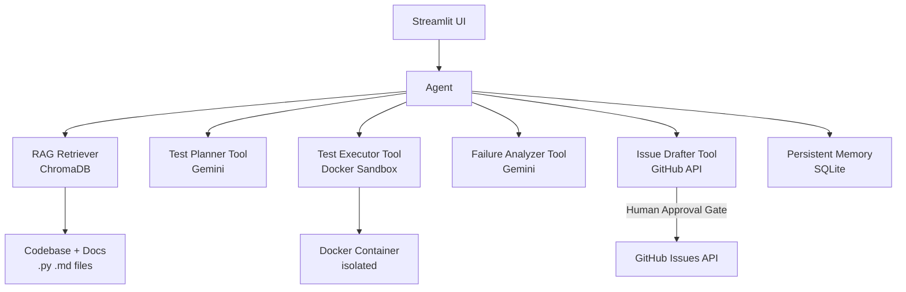

# Implementation Plan — Software-Engineering QA Agent

## Problem Statement
A bounded, agentic QA system that reads its own codebase and docs as a RAG corpus, proposes test plans, executes tests in a Docker sandbox, summarizes failures, and drafts GitHub issues for human approval — built progressively over 8 weeks aligned to the capstone timeline.

## Requirements

**From charter + requirements gathering:**
- **Model:** Gemini (Google AI Studio) — free tier, function-calling support
- **Corpus:** The QA agent's own codebase (self-referential)
- **Sandbox:** Docker-based isolated test execution
- **Vector store:** ChromaDB for RAG
- **GitHub:** Full API integration with human approval gate before posting
- **UI:** Streamlit web interface
- **Agent loop:** Max iterations configurable via `.env` (default 3), hand-off on limit or unrecoverable failure
- **Memory:** Persistent storage of test run history + full drafted issue text
- **Evaluation:** 30 scenarios auto-generated by the agent itself in Week 3, used as acceptance criteria from Week 4 onward
- **Safety:** No auto-merge, no production deployment, no arbitrary shell commands, no secret access

**AI Boundary Matrix:**

| AI May Do | Deterministic Software Controls | Requires Human Approval |
|---|---|---|
| Propose test plans | Execute tests (Docker sandbox) | Submit GitHub issue |
| Generate test code | Validate generated code syntax | Merge any PR |
| Summarize failures | Enforce iteration limits | Any destructive action |
| Draft GitHub issues | Manage API keys & permissions | |
| Retrieve relevant context | Tool allow-list enforcement | |

## Architecture Overview



**Agent loop (bounded):**
```
SENSE   → retrieve relevant code/docs via RAG
PLAN    → generate test plan (Gemini)
ACT     → execute tests in Docker sandbox
OBSERVE → analyze results (Gemini)
DECIDE  → draft issue OR retry (up to MAX_ITERATIONS)
STOP    → hand off to human for approval
```

## Week-to-Task Mapping

| Week | Capstone Focus | Tasks |
|---|---|---|
| Week 1 (Aug 31) | Problem framing, setup | Task 1 |
| Week 2 (Sep 7)  | Prompt engineering       | Task 2 |
| Week 3 (Sep 14) | RAG pipeline             | Task 3 |
| Week 4 (Sep 21) | Tools & function calling | Tasks 4–5 |
| Week 5 (Sep 28) | Bounded agent loop       | Task 6 |
| Week 6 (Oct 5)  | Memory, state, UI        | Task 7 |
| Week 7 (Oct 12) | Evaluation & guardrails  | Tasks 8–9 |
| Week 8 (Oct 19) | Hardening & final release| Task 10 |

---

## Task Breakdown

### Task 1: Project Scaffold & Gemini Baseline

**Objective:** Wire up the project structure, install dependencies, connect to Gemini API, and verify a working model interaction end-to-end.

**Implementation guidance:**
- Populate `requirements.txt` with: `google-generativeai`, `python-dotenv`, `streamlit`, `chromadb`, `PyGithub`, `pytest`, `pytest-cov`, `docker`
- Populate `.env.example` with keys: `GEMINI_API_KEY`, `GITHUB_TOKEN`, `GITHUB_REPO`, `MAX_AGENT_ITERATIONS=3`
- Implement `src/llm_client.py`: a thin wrapper around `google.generativeai` that loads config from `.env`, exposes a `generate(prompt, system_prompt)` function, and logs every call (model, token count, latency)
- Write `prompts/test_planner.txt` prompt spec v1.0: role, task, context placeholder, constraints, output format (structured JSON)
- Write `tests/test_llm_client.py`: mock the Gemini API and assert the wrapper returns a string, logs correctly, and raises a clear error on bad API key
- Populate `README.md` with setup instructions and how to run the project

**Test requirements:** Unit tests for `llm_client.py` with mocked API. At least 3 test cases: happy path, empty response, auth failure.

**Demo:** Running `pytest tests/test_llm_client.py` passes. A small script sends a real prompt to Gemini and prints the response.

---

### Task 2: Prompt Engineering & Versioning

**Objective:** Define, version, and evaluate the core prompts for test planning and failure analysis. Establish the prompt evaluation table (10 cases) required by Week 2.

**Implementation guidance:**
- Create `prompts/test_planner.txt` v1.0 and `prompts/failure_analyzer.txt` v1.0 — each with role, task, context placeholder, constraints, and output format (structured JSON)
- Create `prompts/versions/` folder and copy each version there with a version suffix (e.g. `test_planner_v1.txt`)
- Create `docs/architecture/foundation_model_selection.md` — model rationale, capability, cost, latency, privacy notes
- Build `src/prompt_loader.py`: reads prompts from disk by name and version
- Run 10 manual test cases against each prompt (5 per prompt), record in `docs/evaluation/prompt_eval_table.md`: input → expected output → actual output → pass/fail
- Iterate to v1.1 based on failures; document the change in the versions folder

**Test requirements:** Unit tests for `prompt_loader.py` — assert correct file is loaded, version fallback works, missing file raises `FileNotFoundError`.

**Demo:** Show the prompt eval table with at least 8/10 passing. Show `prompts/versions/` folder with two versioned files and a diff note.

---

### Task 3: RAG Pipeline — Corpus Ingestion & Retrieval

**Objective:** Index the project's own codebase and docs into ChromaDB and retrieve relevant context given a query.

**Implementation guidance:**
- Create `src/rag.py`: crawls `src/`, `tests/`, `prompts/`, `docs/` for `.py` and `.md` files; chunks them by function/section; embeds using Gemini's embedding API (`models/text-embedding-004`); stores in a persistent ChromaDB collection
- Add provenance metadata to each chunk: `file_path`, `chunk_type` (function/class/section), `last_modified`
- Expose a `retrieve(query, top_k=5)` function that returns chunks with their source file path
- Create `knowledge/corpus_register.md` — lists every indexed file, chunk count, and provenance
- Write 15 RAG test questions in `docs/evaluation/rag_eval.md`: 5 answerable, 5 partially answerable, 5 deliberately unanswerable. Record retrieval results and failures.
- Document at least 3 retrieval failure cases and their causes in the same file

**Test requirements:** Unit tests for `rag.py` — mock ChromaDB, assert chunks are stored with correct metadata, assert `retrieve()` returns ranked results, assert empty corpus returns a graceful fallback message.

**Demo:** Type a query like "how does the agent loop work?" and show the top 5 retrieved chunks with their source file paths printed to the console.

---

### Task 4: Tools — Test Planner & Docker Executor

**Objective:** Implement the first two explicit tools: `propose_tests` (uses Gemini + RAG context) and `run_tests` (executes pytest inside Docker). Add tool contracts and authorization.

**Implementation guidance:**
- Create `src/tools.py` with two tools, each defined with a schema dict: `name`, `description`, `input_schema`, `output_schema`, `permissions`, `failure_behaviour`
- `propose_tests(issue_description: str) -> dict`: retrieves context via RAG, calls Gemini with `test_planner.txt` prompt, returns a structured test plan (list of test cases with name, type, code string)
- `run_tests(test_code: str, timeout: int = 30) -> dict`: validates syntax with `ast.parse()`, writes test code to a temp file, spins up a Docker container (`python:3.11-slim`), mounts the temp file, runs `pytest` inside it with the timeout, captures stdout/stderr, cleans up container, returns results dict
- Add a tool allow-list in config — only `propose_tests`, `run_tests`, `analyze_failures`, `draft_issue` are permitted; reject any other tool call
- Test failure scenarios: missing params, syntax-invalid code, Docker unavailable (mock), timeout exceeded
- Create `docs/architecture/tool_catalogue.md` with full schemas and permission notes for both tools

**Test requirements:** Unit tests for both tools with mocked Gemini and mocked Docker client. Test all 4 failure scenarios listed above.

**Demo:** Given a description like "the RAG retriever should handle empty corpus", the agent proposes 3 test cases and runs them in Docker, returning pass/fail results.

---

### Task 5: Tools — Failure Analyzer & Issue Drafter (with Human Approval)

**Objective:** Implement the remaining two tools: `analyze_failures` (Gemini summarization) and `draft_issue` (GitHub API with human approval gate). Complete the Tool Catalogue.

**Implementation guidance:**
- Add to `src/tools.py`:
  - `analyze_failures(test_results: dict) -> dict`: calls Gemini with `prompts/failure_analyzer.txt` prompt, returns structured JSON: `{summary, root_cause, suggested_fix, affected_files}`
  - `draft_issue(analysis: dict, approved: bool = False) -> dict`: constructs a GitHub issue payload (title, markdown body, labels: `["bug", "qa-agent"]`), returns the draft for UI display; only calls `PyGithub` to post when `approved=True`
- Add `prompts/failure_analyzer.txt` v1.0 and version it in `prompts/versions/`
- Add `prompts/issue_drafter.txt` v1.0 for formatting the issue body
- The approval gate is enforced in `src/tools.py`: if `approved=False` (default), return the draft dict without posting; if `approved=True`, post via PyGithub
- Update `docs/architecture/tool_catalogue.md` with the two new tools

**Test requirements:** Unit tests mocking `PyGithub`. Assert issue body is well-formed markdown. Assert posting does NOT happen when `approved=False`. Assert auth errors are surfaced cleanly with a descriptive message.

**Demo:** Run a failing test, get an analysis summary, see the draft issue printed to console, call with `approved=True`, verify it appears in the GitHub repo.

---

### Task 6: Bounded Agent Loop

**Objective:** Wire all four tools into a single goal-directed agent loop with iteration limits, stop conditions, and human hand-off.

**Implementation guidance:**
- Implement `src/agents.py`: a `QAAgent` class with `run(goal: str) -> dict` method
- Loop structure:
  1. **SENSE** — call `rag.retrieve(goal)` to get relevant context
  2. **PLAN** — call `tools.propose_tests(goal + context)`
  3. **ACT** — call `tools.run_tests(test_code)`
  4. **OBSERVE** — call `tools.analyze_failures(results)` if any tests failed
  5. **DECIDE** — if all pass: move to draft; if failures remain and iterations < MAX: loop back to PLAN; if limit reached: hand off
- Read `MAX_AGENT_ITERATIONS` from `.env` (default 3); stop and return a hand-off message when limit is reached
- Stop conditions: all tests pass, unrecoverable error (Docker unavailable), iteration limit hit
- Capture a full execution trace per run: each step name, tool called, input summary, output summary, decision made, timestamp — save as JSON to `evidence/traces/<timestamp>.json`
- Write `docs/architecture/agent_task_contract.md`: goal definition, tools used, state fields, iteration limit, stop conditions, hand-off behaviour

**Test requirements:** Unit tests for `QAAgent` with all tools mocked. Assert loop stops at `MAX_AGENT_ITERATIONS`. Assert trace JSON is written to `evidence/traces/`. Assert hand-off message is returned when limit is hit. Assert loop exits immediately when all tests pass before the limit.

**Demo:** Run the full agent on the goal "test the RAG retriever module" and show the step-by-step trace printed to console, ending with either a drafted issue or a pass confirmation.

---

### Task 7: Memory, State & Streamlit UI

**Objective:** Add persistent memory (run history + drafted issues), explicit session state, and build out the full Streamlit interface.

**Implementation guidance:**
- Create `src/memory.py`: SQLite-backed store (`evidence/qa_agent.db`) with two tables:
  - `runs(run_id TEXT PRIMARY KEY, timestamp TEXT, goal TEXT, trace_json TEXT, status TEXT)`
  - `drafted_issues(issue_id TEXT PRIMARY KEY, run_id TEXT, title TEXT, body TEXT, github_url TEXT, submitted_at TEXT)`
- Expose: `save_run(run_id, goal, trace, status)`, `get_run(run_id)`, `list_runs()`, `save_draft(issue_id, run_id, title, body)`, `update_draft_url(issue_id, github_url)`, `get_draft(issue_id)`
- Add `docs/architecture/memory_design.md`: what is stored, retention policy (manual delete only), access controls (local only), no PII stored policy
- Build `src/main.py` as the Streamlit app with:
  - **Sidebar:** run history list (most recent first), clickable to load a past run
  - **Main panel:** goal text input, "Run Agent" button, live step progress display, trace viewer (expandable JSON), issue draft preview with "Submit to GitHub" approval form
  - **Past Runs page:** table of all runs with status, link to view trace and drafted issue
- Wire `st.session_state` so current run is not lost on widget interaction
- Integrate `QAAgent`, all tools, RAG, and memory into the Streamlit app flow

**Test requirements:** Unit tests for `memory.py` — assert save/retrieve round-trips correctly, assert `list_runs()` returns runs in reverse-chronological order, assert missing `run_id` returns `None` gracefully.

**Demo:** Run the agent twice via the UI. Reload the page. Show both runs in the sidebar history. Click one to view its trace and drafted issue.

---

### Task 8: Evaluation Dataset (Auto-generated) & Observability

**Objective:** Use the agent to generate its own 30-scenario evaluation suite, then add structured logging/tracing and guardrails throughout.

**Implementation guidance:**
- Write `scripts/generate_eval_scenarios.py`: prompts Gemini with full corpus context to propose 30 evaluation scenarios across 6 categories:
  - Normal (8): standard happy-path goals
  - Edge (6): unusual but valid inputs (empty files, single-line modules)
  - Incorrect-information (4): goals referencing non-existent modules
  - Adversarial (6): prompt injection attempts, jailbreak patterns
  - Tool-failure (4): simulate Docker down, GitHub auth failure
  - Unauthorized-action (2): attempt auto-merge, attempt production deploy
- Store in `docs/evaluation/eval_scenarios.json` — each entry: `{id, category, input, expected_behaviour, pass_criteria}`
- Add structured logging throughout `src/` using Python's `logging` module configured to output JSON-lines to `evidence/traces/app.log`: log every tool call (name, input hash, output hash, latency_ms), every LLM call (prompt hash, token count, latency_ms), every agent decision, every error with stack trace
- Add guardrails in `src/agents.py` and `src/tools.py`:
  - Input length limit: reject goals > 2000 characters
  - Prompt injection detection: reject inputs containing patterns like "ignore previous instructions", "you are now", "disregard your"
  - Output schema validation: assert tool outputs match expected dict structure before passing to next step
  - Agent iteration hard cap: enforce `MAX_AGENT_ITERATIONS` even if code logic has a bug
- Write `docs/evaluation/observability_notes.md`: what is logged, log format, how to read traces

**Test requirements:** Assert guardrails block the 2 unauthorized-action scenarios and at least 4 adversarial scenarios. Assert JSON-lines log is written for every agent run. Assert eval_scenarios.json contains exactly 30 entries across the 6 categories.

**Demo:** Show the eval scenario list in the Streamlit UI. Run 5 scenarios live. Show the JSON-lines log for one run. Show a guardrail blocking a prompt injection attempt with a clear error message.

---

### Task 9: Evaluation Completion, Failure Catalogue & Hardening

**Objective:** Run all 30 evaluation scenarios, document genuine failures, fix critical defects, and produce the Failure Catalogue required by Week 7.

**Implementation guidance:**
- Run all 30 scenarios from `eval_scenarios.json`; record pass/fail/partial in `docs/evaluation/eval_results.md` with columns: `id`, `category`, `input`, `expected`, `actual`, `status`, `latency_ms`, `notes`
- Measure and record for each: task completion (binary), groundedness (did response cite source?), tool selection accuracy (correct tool called?), instruction following (output matched schema?), latency, safety violations
- Create `docs/evaluation/failure_catalogue.md` with at least 5 genuine failures:
  - `failure_id`, `scenario_id`, `description`, `root_cause`, `fix_applied`, `retest_status`
- Fix all critical defects found during evaluation runs; document non-critical ones as known limitations in `README.md`
- Security hardening review:
  - Verify all secrets are in `.env` only and `.env` is in `.gitignore`
  - Verify Docker containers are always cleaned up (even on exception — use try/finally)
  - Verify GitHub token scope is `repo` (issues read/write) only
  - Verify prompt injection guardrail covers all input entry points
- Run `pytest --cov=src tests/` and ensure ≥70% line coverage; add missing tests where coverage is low

**Test requirements:** Full test suite run with `pytest --cov` producing a coverage report. All previously failing tests re-run after fixes. Failure catalogue `retest_status` column must show `PASS` for all fixed items.

**Demo:** Show the complete eval results table (30 rows) in `docs/evaluation/eval_results.md`. Show 2 before/after entries from the failure catalogue. Show `pytest --cov` terminal output with the coverage summary.

---

### Task 10: Final Release, Report & Presentation Prep

**Objective:** Tag a reproducible release, complete all documentation artifacts, and prepare the final demo.

**Implementation guidance:**
- Write complete `README.md` with:
  - Problem statement (2–3 sentences)
  - Quick-start: `git clone` → copy `.env.example` to `.env` and fill keys → `docker pull python:3.11-slim` → `pip install -r requirements.txt` → `streamlit run src/main.py`
  - Architecture summary (reference the mermaid diagram)
  - Known limitations section
- Complete all previously stubbed doc files:
  - `docs/requirements/user_stories.md`: 8–12 user stories with acceptance criteria
  - `docs/architecture/architectural_diagrams.md`: finalized mermaid diagrams
  - `docs/weekly_reports/week1/week_1.md` through `week8/week_8.md`: one progress report per week
- Final version of `docs/architecture/foundation_model_selection.md`
- Assemble `evidence/` pack: 3 execution traces (happy path, recovery, limit-hit), eval results, failure catalogue, at least 2 screenshots
- Tag the Git release as `v1.0.0` with a release note summarizing what was built
- Prepare the 12–15 min presentation outline:
  1. Problem & target user (1–2 min)
  2. Architecture progression: model → RAG → tools → bounded agent → evaluation (2 min)
  3. Live end-to-end workflow demo (4 min)
  4. One engineering evidence view: show a JSON trace or eval run (2 min)
  5. One real failure from the failure catalogue (2 min)
  6. Guardrails, human approval boundaries, key lessons (1–2 min)

**Test requirements:** Full clean install from scratch (delete venv, reinstall from `requirements.txt`) to verify no missing dependencies. Smoke test: run the Streamlit app end-to-end in a clean environment.

**Demo:** Live end-to-end: enter a goal in the UI → agent runs all steps → tests execute in Docker → failure analyzed → issue drafted → user clicks "Submit to GitHub" → issue appears in the GitHub repo. Then show one trace and one failure catalogue entry.

---

## Key File Reference

| File | Purpose |
|---|---|
| `src/llm_client.py` | Gemini API wrapper with logging |
| `src/prompt_loader.py` | Load and version prompts from disk |
| `src/rag.py` | ChromaDB ingestion and retrieval |
| `src/tools.py` | All four tool implementations |
| `src/agents.py` | Bounded QAAgent loop |
| `src/memory.py` | SQLite persistent memory |
| `src/main.py` | Streamlit UI entry point |
| `prompts/test_planner.txt` | Test planning prompt |
| `prompts/failure_analyzer.txt` | Failure analysis prompt |
| `prompts/issue_drafter.txt` | Issue body formatting prompt |
| `prompts/versions/` | Versioned prompt history |
| `docs/architecture/tool_catalogue.md` | Tool schemas and permissions |
| `docs/architecture/agent_task_contract.md` | Agent goal, limits, stop conditions |
| `docs/architecture/memory_design.md` | Memory design and data handling |
| `docs/evaluation/eval_scenarios.json` | 30 auto-generated eval scenarios |
| `docs/evaluation/eval_results.md` | 30-scenario evaluation results |
| `docs/evaluation/failure_catalogue.md` | Genuine failures with remediation |
| `docs/evaluation/observability_notes.md` | Logging and tracing documentation |
| `evidence/traces/` | JSON execution traces per run |
| `evidence/traces/app.log` | JSON-lines structured log |
| `scripts/generate_eval_scenarios.py` | One-off eval scenario generator |
| `.env.example` | Environment variable template |
| `requirements.txt` | Pinned Python dependencies |
