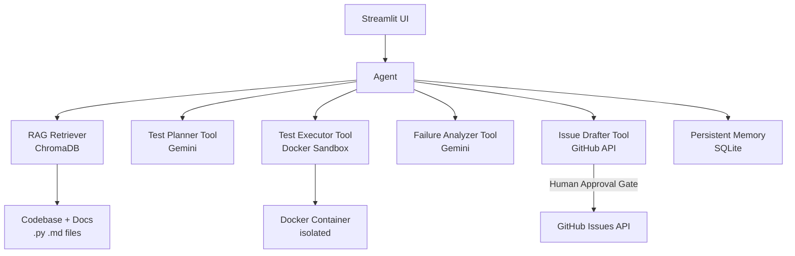

# Software-Engineering QA Agent

A bounded, agentic QA system that reads its own codebase and docs as a RAG corpus,
proposes test plans, executes tests in a Docker sandbox, summarizes failures, and drafts
GitHub issues for human approval.

Built as a BSE4104 capstone project over 8 weeks.

---

## Quick Start

### 1. Prerequisites

- Python 3.11+
- Docker Desktop (running) — used for sandboxed test execution
- A [Google AI Studio](https://aistudio.google.com/app/apikey) account (free tier)
- A GitHub personal access token with `repo` scope (issues read/write)

### 2. Clone and configure

```bash
git clone <your-repo-url>
cd qa-agent

# Copy the environment template and fill in your keys
cp .env.example .env
```

Open `.env` and set at minimum:

```
GEMINI_API_KEY=your_key_here
GITHUB_TOKEN=your_token_here
GITHUB_REPO=your_username/your_repo
```

### 3. Install dependencies

```bash
pip install -r requirements.txt
```

### 4. Pull the Docker sandbox image

```bash
docker pull python:3.11-slim
```

### 5. Run the Streamlit UI

```bash
streamlit run src/main.py
```

The app will open at `http://localhost:8501`.

---

## Running Tests

```bash
# Run all unit tests
pytest tests/ -v

# Run with coverage report
pytest tests/ --cov=src --cov-report=term-missing
```

---

## Project Structure

```
.
├── src/
│   ├── llm_client.py       # Gemini API wrapper with logging
│   ├── prompt_loader.py    # Load and version prompts from disk
│   ├── rag.py              # ChromaDB ingestion and retrieval
│   ├── tools.py            # All four tool implementations
│   ├── agents.py           # Bounded QAAgent loop
│   ├── memory.py           # SQLite persistent memory
│   └── main.py             # Streamlit UI entry point
├── prompts/
│   ├── test_planner.txt    # Test planning prompt (versioned)
│   ├── failure_analyzer.txt
│   ├── issue_drafter.txt
│   └── versions/           # Prompt version history
├── tests/                  # pytest unit tests
├── docs/
│   ├── requirements/       # User stories and acceptance criteria
│   ├── architecture/       # Diagrams, tool catalogue, model selection
│   ├── evaluation/         # Eval scenarios, results, failure catalogue
│   └── weekly_reports/     # One report per week
├── knowledge/              # Corpus register (no restricted data committed)
├── evidence/
│   ├── traces/             # JSON execution traces and app.log
│   └── screenshots/        # Demo screenshots
├── scripts/
│   └── generate_eval_scenarios.py
├── requirements.txt
├── .env.example            # Environment variable template
└── IMPLEMENTATION_PLAN.md  # Full 10-task build plan
```

---

## Architecture



**Agent loop (bounded, max iterations from `.env`):**

```
SENSE   → retrieve relevant code/docs via RAG
PLAN    → generate test plan (Gemini)
ACT     → execute tests in Docker sandbox
OBSERVE → analyze results (Gemini)
DECIDE  → draft issue OR retry (up to MAX_ITERATIONS)
STOP    → hand off to human for approval
```

---

## AI Boundaries

| AI May Do | Deterministic Software Controls | Requires Human Approval |
|---|---|---|
| Propose test plans | Execute tests (Docker sandbox) | Submit GitHub issue |
| Generate test code | Validate generated code syntax | Merge any PR |
| Summarize failures | Enforce iteration limits | Any destructive action |
| Draft GitHub issues | Manage API keys & permissions | |
| Retrieve relevant context | Tool allow-list enforcement | |

---

## Known Limitations

- Requires Docker Desktop running locally; tests will not execute without it.
- Generated test code is syntax-validated but not semantically reviewed before execution.
- RAG corpus is re-indexed on each run unless the ChromaDB persist directory already exists.
- GitHub issue posting requires a valid token with `repo` scope; read-only tokens will fail at the approval step.

---

## Security Notes

- Never commit `.env` — it is listed in `.gitignore`.
- All secrets are loaded exclusively from `.env` via `python-dotenv`.
- Docker containers are cleaned up after every test run (including on failure).
- No production systems are accessed or modified by this agent.

---

## Week-by-Week Build Plan

See [`IMPLEMENTATION_PLAN.md`](IMPLEMENTATION_PLAN.md) for the full 10-task plan
aligned to the 8-week capstone timeline.

---

## References

1. Osmani, A. (2025). *Beyond Vibe Coding: From Coder to AI-Era Developer.* O'Reilly Media.
2. Huyen, C. (2025). *AI Engineering: Building Applications with Foundation Models.* O'Reilly Media.
3. Lanham, M. (2025). *AI Agents in Action.* Manning Publications.
