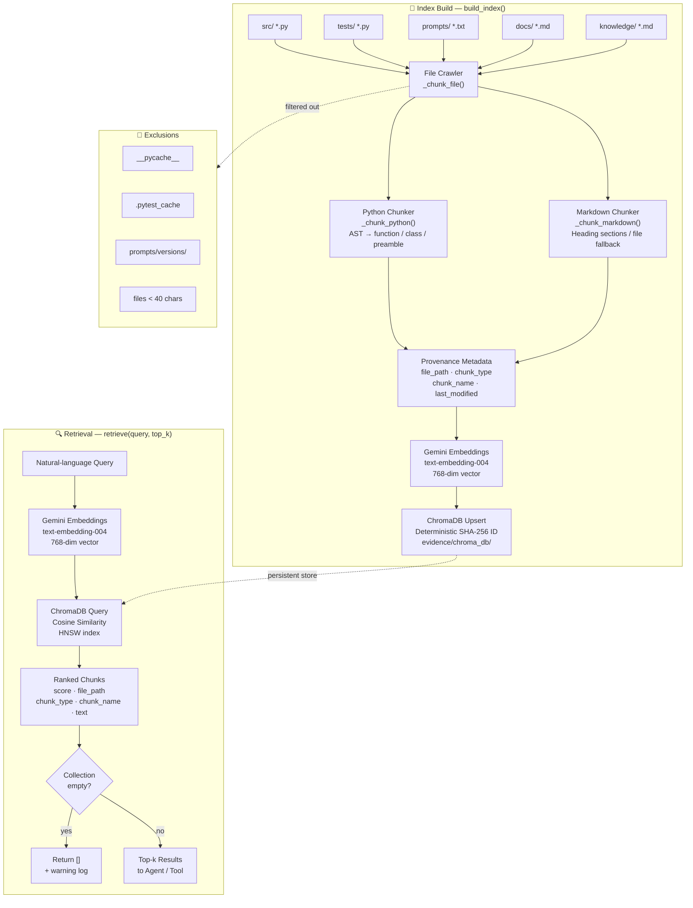

# Architectural Diagrams

---

## RAG Pipeline Architecture

**Key design decisions:**
- **AST chunking for Python** — keeps each function and class self-contained rather than splitting mid-definition.
- **Heading-based chunking for Markdown** — one section per chunk gives the retriever a coherent semantic unit.
- **Deterministic SHA-256 IDs** — `build_index()` is fully idempotent; re-running updates changed chunks in place.
- **Empty-collection guard** — `retrieve()` returns `[]` with a warning rather than raising, so the agent loop handles it gracefully.
- **Exclusion list** — `__pycache__`, `.pytest_cache`, `prompts/versions/`, and sub-40-char files are skipped to avoid noise.
